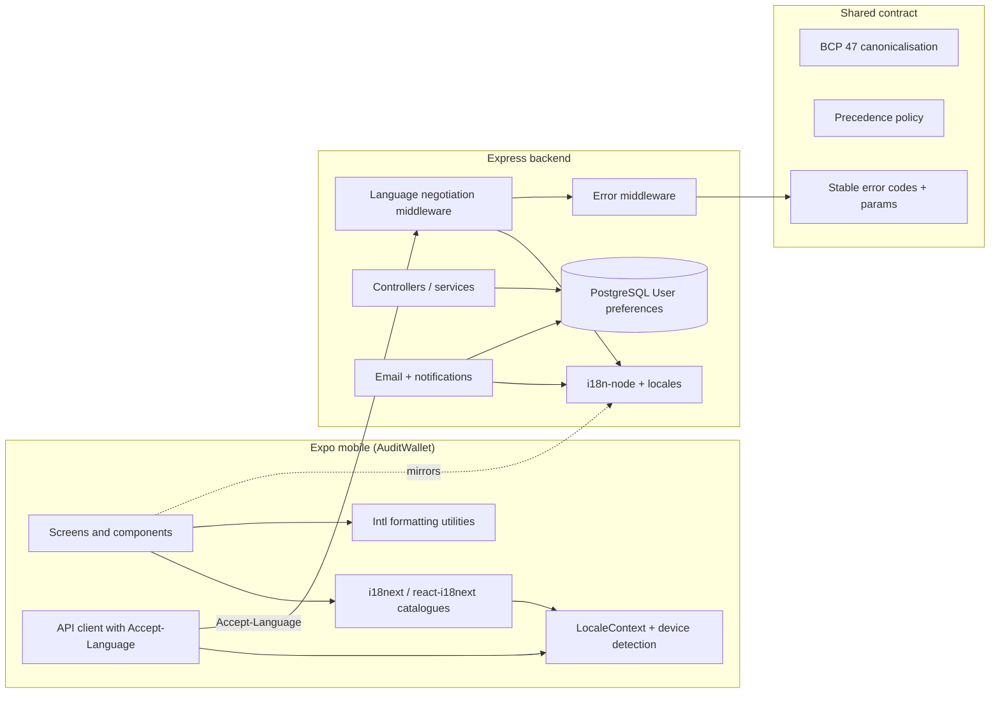
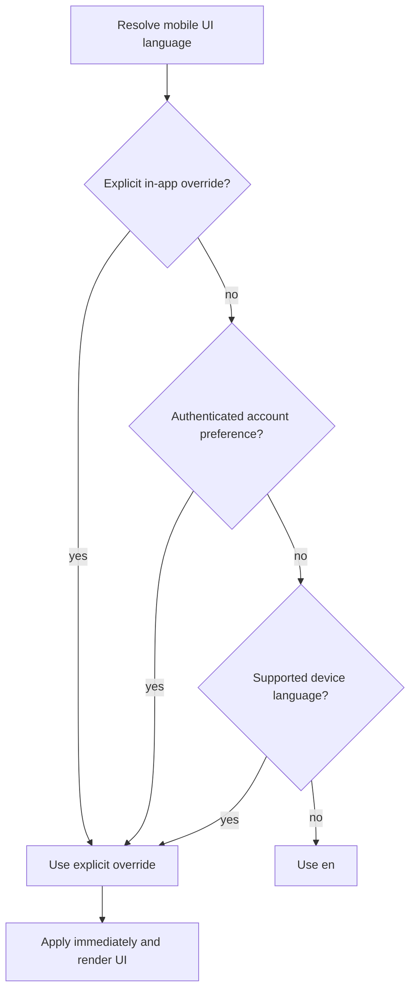
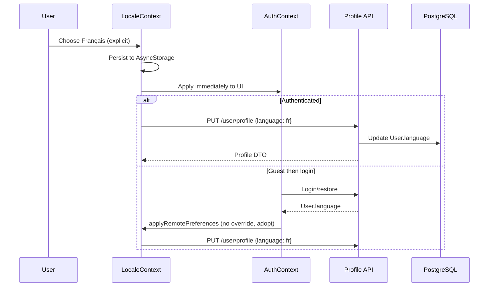
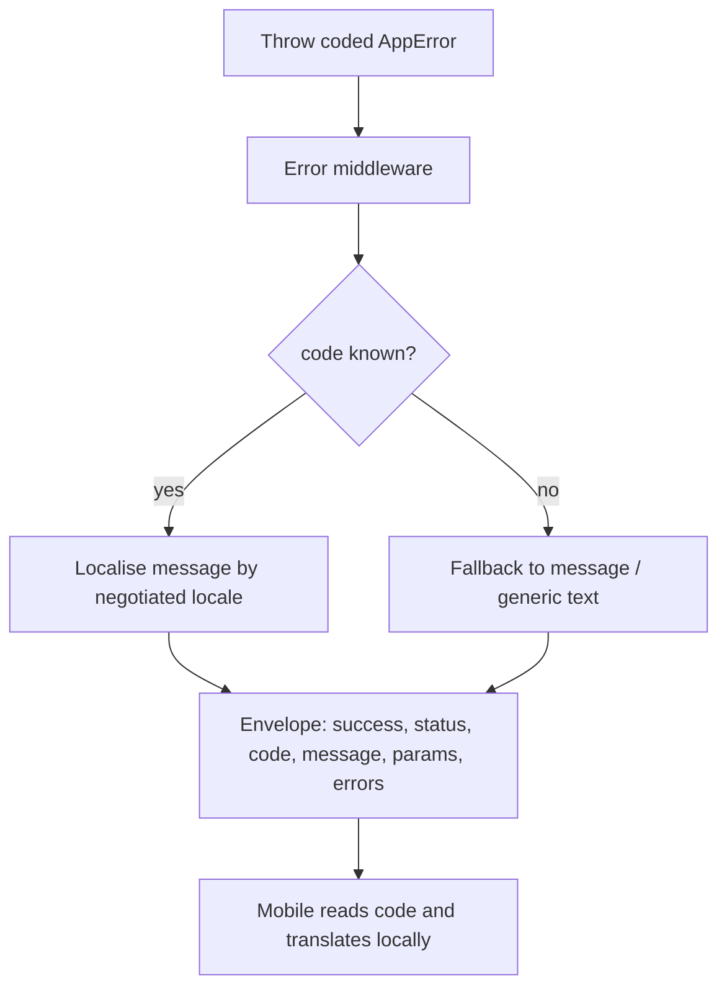
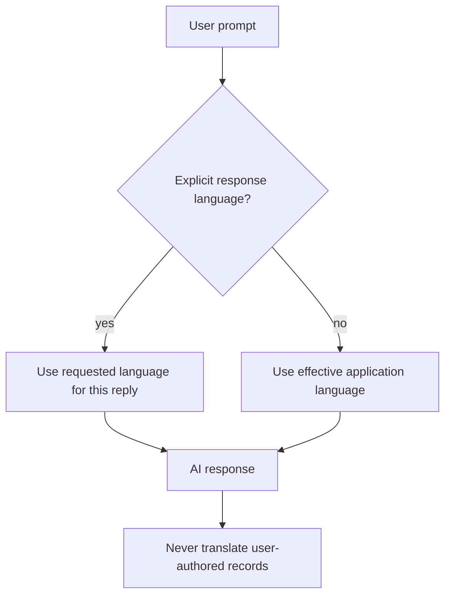

# Internationalisation and Localisation Architecture

## 1. Purpose and scope

This document defines the approved target architecture for multilingual
support in the product. It covers the backend (Express 5, JavaScript, Prisma 7, PostgreSQL), the mobile application (Expo SDK 57, React Native, TypeScript, Expo Router), their shared contracts, and the migration from the current partial implementation to the approved design.

The fourteen approved decision statements are recorded in
[`docs/decisions/0004-internationalisation-architecture.md`](../decisions/0004-internationalisation-architecture.md).
This document describes the target design; it does not claim that every
described behaviour is already deployed.

## 2. Existing implementation

The current state is summarised below. File references are current at the time
of writing.

- **Backend catalogues.** `i18n-node` loads `src/backend/src/locales/en.json`
  and `fr.json`, generated from `src/backend/translations/en.js` and
  `src/backend/translations/fr.js` by `src/backend/scripts/generate.locales.js`.
  A stray `src/backend/src/locales/og.json` is not registered.
- **Backend negotiation.** `src/backend/src/middleware/lang.middleware.js`
  resolves the request locale through `src/backend/src/utils/locale.js` and
  falls back to `en` for unsupported or malformed values. It runs before
  authentication, so `request.user.language` is re-applied by the auth
  middleware once the user is attached.
- **Backend error contract.** `src/backend/src/middleware/error.middleware.js`
  returns `{ success, status, code, message, params, errors, stack? }` with a
  stable machine-readable `code`. Identifiers are declared in
  `src/backend/src/constants/error-codes.js` and mirrored by the mobile
  catalogue in `src/mobile/src/api/errors.ts`; Joi field errors use
  `{ field, code, message, params }`.
- **Backend content.** Email subjects and some auth messages use
  `i18n.__`; most controllers and services return hardcoded English.
- **Preferences.** `User` stores `language` (`en`), `currency` (`USD`),
  `timezone` (`UTC`), and `theme` (`light`) in
  `src/backend/src/prisma/models/user.prisma`.
- **Money.** `Transaction.amount` and `Budget.amount` are Prisma `Decimal` /
  PostgreSQL `NUMERIC(19,4)`; `src/backend/src/utils/money.js` provides
  canonical decimal normalisation and exact sums.
- **Mobile detection.** `src/mobile/src/contexts/LocaleContext.tsx` drives
  `expo-localization`, AsyncStorage persistence, and
  `src/mobile/src/localization/{detect,format,storage,systemCategories}.ts`.
- **Mobile UI.** `i18next` / `react-i18next` provide source-as-key feature
  catalogues for `common`, `auth`, `dashboard`, `transactions`, `planning`,
  `teams`, `profile`, and `notifications`. Money/date formatting and
  system-category labels are localised.

## 3. Target architecture

The target architecture is a shared contract with separated implementation
responsibilities:

- The backend owns server-generated content, language negotiation for API
  responses, and the persistent preference store.
- The mobile application owns UI strings and presentation formatting.
- A shared contract defines locale identifiers, language precedence, stable
  error codes, message parameters, and terminology.



## 4. Technology responsibilities

| Layer | Responsibility |
|---|---|
| Backend `i18n-node` | Server-side message catalogues, email rendering, API message localisation |
| Mobile `i18next` / `react-i18next` | UI catalogue loading, namespaces, interpolation, pluralisation, runtime switching |
| `expo-localization` + `LocaleContext` | Device language and currency detection, local cache, preference plumbing |
| `Intl` | Currency, number, date, and relative-time formatting on both sides |
| PostgreSQL `User` | Persistent language/currency/timezone/theme preferences |

## 5. Supported languages

- English (`en`) — canonical fallback.
- French (`fr`).

Adding a language later requires a backend catalogue, a mobile catalogue, a
registry entry on each side, and CI parity checks — not an architectural
change.

## 6. Locale canonicalisation

Catalogue identifiers are lowercase language-only BCP 47 primary subtags.
Regional variants are matched to their base language:

| Requested locale | Catalogue |
|---|---|
| `en` | `en` |
| `en-GB` | `en` |
| `en-US` | `en` |
| `fr` | `fr` |
| `fr-FR` | `fr` |
| `fr-CA` | `fr` |
| `de-DE` | `en` (fallback) |

Parsing rules:

- Trim and lowercase the primary subtag.
- A full `Accept-Language` list is parsed into ordered, q-weighted entries;
  the first entry whose base language is supported wins.
- Malformed identifiers are ignored and treated as absent.
- Unsupported languages fall back to `en`, never error.
- A translation language never determines currency, country, or timezone.

## 7. Language resolution

The effective language is resolved per execution context.

| Context | Resolution order |
|---|---|
| Mobile UI | 1. explicit in-app override · 2. authenticated account preference · 3. supported device language · 4. `en` |
| Authenticated API request | 1. authenticated `User.language` · 2. explicit `Accept-Language` / `lang` · 3. `en` |
| Anonymous API request | 1. negotiated `Accept-Language` · 2. explicit `lang` query · 3. `en` |
| Background tasks (email, notifications, export) | 1. `User.language` · 2. `en` |



## 8. Guest and authenticated flows

- **Guest.** The app uses an explicit override if present, otherwise the
  detected device language. Automatic detection is not persisted as a
  preference.
- **Authenticated.** The app adopts the account language unless the user has
  an explicit local override. A device-detected default never overwrites an
  existing account preference.
- **Logout.** Explicit device overrides remain; adopted account preferences
  are dropped so the device language applies again.
- **Account switching.** Preferences are re-hydrated from the new account;
  explicit device overrides take precedence.

## 9. Preference synchronisation

The backend is the persistent store; the mobile cache exists for immediate
rendering and offline use.

- **Hydration.** On startup the local cache renders first; on session restore
  the profile's `language`/`currency` are adopted non-persistently.
- **Explicit update.** An explicit user choice is written to the cache and,
  when authenticated, to `PUT /user/profile`.
- **Pending/failed sync.** A failed update keeps the local choice applied,
  records a pending state, and retries on next foreground/session restore.
- **Loop avoidance.** `LocaleContext` owns local choice; `AuthContext` only
  supplies remote preferences via `applyRemotePreferences`. Remote values are
  adopted only when there is no explicit local override.



## 10. API language propagation

The mobile API client attaches the resolved `Accept-Language` to every
request. For authenticated requests the backend may prefer the stored account
language over the header; for anonymous requests the header is the primary
signal. The `lang` query parameter remains supported for explicit callers.

```mermaid
sequenceDiagram
    participant M as Mobile client
    participant N as Negotiation middleware
    participant A as Auth middleware
    participant C as Controller

    M->>N: Request with Accept-Language: fr-CA, fr;q=0.9
    N->>N: Parse + canonicalise -> fr
    Note over N: Anonymous: fr is negotiated locale
    A->>C: Attach request.user (authenticated)
    C->>C: Effective locale = user.language ?? negotiated
    C-->>M: Localised message + stable code
```

## 11. Structured error contract

Errors remain backward compatible and add a stable `code`:

```json
{
  "success": false,
  "status": 409,
  "code": "BUDGET_LIMIT_EXCEEDED",
  "message": "Budget limit exceeded",
  "params": { "limit": "500.00", "currency": "GBP" },
  "errors": null
}
```

- `code` is stable and machine-readable; `message` is the localised
  human-readable text; `params` supplies interpolation values.
- Validation failures use `errors` as an array of
  `{ field, code, message, params }`.
- Unknown or missing codes fall back to the localised `message`, then to a
  generic client-side string.
- The contract is additive; `success`, `status`, `message`, and `errors`
  remain present.



## 12. Translation ownership

| Content | Owner |
|---|---|
| Navigation labels, screen titles, buttons, form labels | Mobile |
| Client-side validation, loading/empty states, accessibility labels | Mobile |
| Client-side error presentation | Mobile |
| Emails, background notifications, backend reports | Backend |
| Server-side validation/domain error semantics and codes | Backend |
| API response localisation | Backend |
| System-defined category labels | Backend IDs + mobile labels |
| User-authored descriptions, merchant names, notes | Never auto-translated |

Catalogues are separate. The mobile app does not duplicate the backend
catalogue; shared contracts cover stable error codes, locale identifiers,
message parameters, and terminology.

## 13. Backend-generated content

Emails and notifications render in `User.language` with fallback to `en`,
because there is no active HTTP request. Currency and date formatting inside
templates use `Intl` with the recipient's language, currency, and timezone.
Reports and exports include the user's timezone and currency but never mutate
stored financial values.

## 14. AI response language

The AI chat defaults to the effective application language. A user may
explicitly request a different response language. These are distinct:

- Application interface language.
- Default AI response language (derived from the effective language).
- Explicit user-requested response language for a single exchange.
- User-generated financial content, which is never auto-translated.

The current AI screen is local-only with no backend endpoint; the contract
below is the intended integration, not existing functionality.



## 15. Financial localisation boundaries

Language, currency, region, and timezone are independent. Formatting is
presentation-only and never converts currency or changes stored values.
Details are in
[`docs/engineering/financial-localisation.md`](../engineering/financial-localisation.md).

## 16. Security and privacy

- Interpolation is parameterised; translated strings are not executed.
- HTML is only emitted by explicitly trusted email templates.
- Locale input is validated, canonicalised, and falls back safely.
- Preference updates are authenticated and ownership-scoped.
- Error responses expose only documented, parameterised data; no tokens,
  hashes, or unrelated personal data are included in translated messages.

## 17. Offline behaviour

Mobile catalogues are bundled assets, so translation works offline. The local
preference cache renders immediately. Pending synchronisation is retried when
connectivity returns. A failed explicit preference update never blocks UI
rendering in the chosen language.

## 18. Migration and compatibility

- Backend catalogues and the `i18n-node` pipeline remain.
- Mobile detection/preference infrastructure remains and is extended with
  `i18next`/`react-i18next`.
- The error contract is additive; no existing key is removed.
- No database migration is required.

## 19. Testing strategy

See
[`docs/audits/internationalisation-gap-analysis.md`](../audits/internationalisation-gap-analysis.md)
for the full test matrix. CI enforces catalogue parity, placeholder
compatibility, unsupported-locale fallback, stable error-code mappings,
runtime language switching, and financial formatting regressions.

## 20. Future-language expansion

1. Add `src/backend/translations/<code>.js` and regenerate
   `src/backend/src/locales/<code>.json`.
2. Add the mobile authoring files under
   `src/mobile/src/i18n/locales/<code>/` for `auth`, `dashboard`,
   `transactions`, `planning`, `errors`, and `index`.
3. Add `<code>` to `src/backend/src/constants/localization.js` and
   `src/mobile/src/localization/registry.ts`.
4. Add `<code>` entries to the hand-maintained
   `src/mobile/src/i18n/messages/common.ts` and plural catalogues.
5. Register the new language in `src/mobile/src/i18n/index.ts`.
6. Regenerate mobile catalogues from `src/mobile` with
   `node scripts/build-message-catalogues.mjs`.
7. Run the catalogue parity and CI checks.
8. Add any regional formatting metadata independently if needed.
