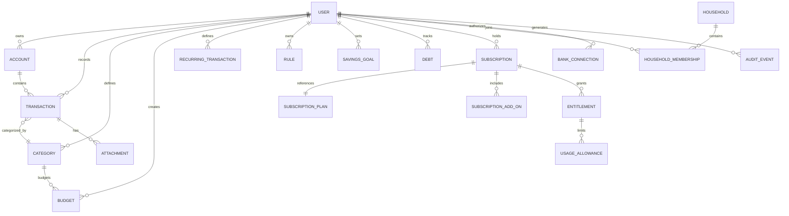

# Product Domain Design (Conceptual)

**Status:** Proposal. This describes conceptual future boundaries only. It does **not** modify Prisma schemas, generate migrations, or redesign the backend architecture. The diagram is conceptual, not the current database schema.

## Current vs proposed entities

### Existing (in code today)
- `User` — identity, credentials, preferences (`currency`, `timezone`, `language`, `theme`).
- `Transaction` — amount, type, category (string), date, description, receipt URL, location.
- `Category` — system or user-defined category.
- `Budget` — amount, period, dates, alert threshold, category and user links.
- `RefreshToken`, `VerificationToken`, `PasswordResetToken`, `LoginAttempt`, `PasswordHistory` — auth/audit support.
- `Notification` — defined but unused.

### Proposed (future, conceptual only)
- `Account` — a manual or connected financial account (see below).
- `RecurringTransaction` — a rule for scheduled transactions and reminders.
- `Attachment` — receipt images/documents linked to a transaction.
- `Rule` — user-owned categorization/merchant rules.
- `SavingsGoal` — target amount/date with progress.
- `Debt` — liability with balance, rate, and payoff projection inputs.
- `Household` and `HouseholdMembership` — shared financial space with roles.
- `SubscriptionPlan`, `Subscription`, `SubscriptionAddOn`, `Entitlement`, `UsageAllowance` — commercial model.
- `BankConnection` — consent-scoped link to an aggregator/AISP account (future).
- `AuditEvent` — tamper-evident record of security-relevant changes.

## Conceptual entity relationships

## Financial accounts
The proposed `Account` entity represents a source of transactions.

- **Ownership:** one `User` owns an `Account`; it may be linked to a shared household space only through explicit sharing rules.
- **Account types:** manual bank account, cash, credit card, and (future) connected bank account.
- **Currency:** an account has one currency; multi-currency requires explicit conversion rules.
- **Opening balance:** an optional starting balance provides the base for balance calculation.
- **Balance calculation:** derived from opening balance plus cleared transactions; not stored as a mutable single number.
- **Manual vs connected:** manual accounts are user-maintained; connected accounts refresh via consent-scoped `BankConnection`.
- **Transfers:** a transfer is two linked transaction legs (outflow in one account, inflow in another) that cancel out in net totals.
- **Reconciliation:** users mark transactions as reconciled against a statement balance.
- **Archival:** accounts are archived rather than deleted when they have historical transactions.
- **Transaction relationship:** an `Account` contains many `Transaction`s; a transaction belongs to exactly one account.

## Transactions and categories
- **Initial domain:** one transaction has exactly one category (many-to-one). This matches the current single `Transaction.category` string and keeps budget aggregation unambiguous.
- **Future capability:** transaction splitting is a separate feature that would introduce a transaction-split line model, not a many-to-many `Transaction`↔`Category` link.
- **Existing mismatch:** today `Transaction.category` is a string while `Budget.categoryId` references the `Category` table. These must be aligned (either normalize transactions to a category relation or change budget scoping) before budget aggregation can be correct.
- **Subcategories:** introduced later as a parent/child relationship within `Category`, not as additional transaction links.

## Financial correctness invariants
Conceptual invariants for future implementation:
- **Exact arithmetic:** money uses exact representation (integer minor units or `Decimal`), never binary floating point for calculations.
- **Currency precision:** precision is defined per currency; conversions record source, rate, and timestamp.
- **Rounding:** rounding happens at defined boundaries (e.g., currency conversion or report aggregation), not repeatedly during sums.
- **Transfers:** transfer legs are equal and opposite in amount; net income/expense excludes transfers.
- **Income and expenses:** sign convention is explicit; `transType` distinguishes income/expense rather than sign alone.
- **Transaction dates:** store timestamps in UTC; derive financial periods from the user's timezone.
- **Budget periods:** period boundaries are deterministic and timezone-aware; rollover rules are explicit.
- **Idempotency:** duplicate submissions and sync retries must not create duplicate transactions.
- **Duplicate prevention:** deterministic matching (amount, account, date window, normalized description) with user confirmation before automatic deduplication.
- **Balance reconciliation:** account balance equals opening balance plus the sum of cleared transaction legs within the account's currency.

A representation decision (integer minor units vs Prisma `Decimal`) requires documented trade-offs and product/engineering approval; this document does not choose one.

## Household ownership
- **Personal ownership:** accounts, transactions, budgets, goals, and debts are private by default.
- **Shared ownership:** a `Household` owns shared budgets, goals, and shared transaction spaces; personal entities are explicitly moved into shared spaces.
- **Membership:** invitations require acceptance; membership has an owner, admins, and members.
- **Roles:** owner/admin manage membership and shared spaces; members act within granted permissions.
- **Access revocation:** removing a member revokes access to shared spaces but not their private data.
- **Shared records:** records created in a shared space belong to the household, not the creating member's private account.
- **Dissolution:** on household dissolution, shared records must be exported or reassigned per an explicit policy.
- **Consent:** sharing financial data requires informed consent; sharing is never implied by being in the same subscription.
- **Design guardrail:** shared finances must not become unrestricted access to another user's personal financial data.

## Subscriptions and entitlements
Use consistent terminology:
- **SubscriptionPlan** — a catalog definition (Free, Plus, Pro) with feature rules and limits.
- **Subscription** — one user's active instance of a plan, with lifecycle state (`trial`, `active`, `past_due`, `canceled`, `expired`).
- **SubscriptionAddOn** — an optional addition to a subscription (e.g., Family).
- **Entitlement** — a granted capability derived from the plan plus add-ons.
- **UsageAllowance** — a counted limit attached to an entitlement (attachments, connected accounts, AI queries).

- **Subscription ownership:** a subscription belongs to an individual user; it is not the same as household membership.
- **Household relationship:** the Family add-on is attached to the billing owner's subscription and enables household features for that household; members do not each need a Family subscription.
- **Downgrade behavior:** paid write-actions become read-only; historical data remains visible and exportable.
- **Lifecycle:** trial, cancellation, and renewal states are distinct from capability enforcement.

## Audit events (conceptual requirements)
Audit, without logging secrets or unnecessary sensitive values, for:
- Authentication and account-security changes (login, password change, token refresh/revocation).
- Sensitive financial record changes (large edits, deletions, transfers).
- Household membership changes (invitation, acceptance, role change, removal).
- Subscription changes (plan, add-on, trial, cancellation).
- Bank consent changes (authorization, re-authorization, revocation).
- Data export and account deletion.

Audit records store actor, action, target type, timestamp, and a minimal, non-sensitive outcome; they do not store tokens, passwords, or raw financial payloads.

## Data lifecycle requirements (product-level)
- Transactions and budgets are retained while the account exists, then exported or deleted on request.
- Attachments inherit the transaction's retention and deletion scope.
- Revoked tokens and login attempts have shorter retention windows.
- Bank connection data must be refreshable, revocable, and re-consented per applicable rules and provider requirements.
- Deletion covers backups and derived analytics within a documented window.

## Explicit non-goals for this document
- No Prisma schema changes or migrations.
- No backend layering redesign or microservice decomposition.
- No billing/payment infrastructure design (deferred to the infrastructure phase).
