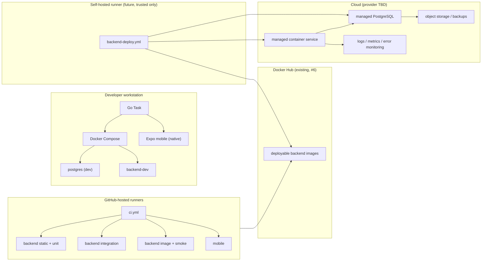
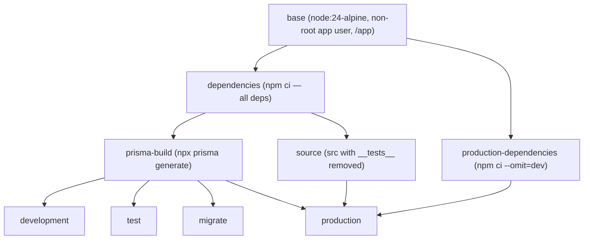

# Infrastructure Architecture

**Status:** Proposed direction. "Current" statements are verified against the repository; "target" statements are planned and marked as such.

## 1. Purpose and scope

This document is the authoritative overview of the product's target infrastructure. It covers local onboarding, reproducible builds, containerized testing, automated pull-request validation, publishing, deployment, release, cloud provisioning, teardown, monitoring, and recovery. Detailed policies live in the dedicated documents linked below; this file keeps the system-level picture coherent.

- [CI/CD architecture](ci-cd.md)
- [Release engineering](release-versioning.md)
- [Cloud and IaC](cloud-and-iac.md)
- [Ephemeral environments](ephemeral-environments.md)
- [Phased roadmap](ci-cd-roadmap.md)

## 2. Verified current state

- Two-package monorepo orchestrated by Go Task (`Taskfile.yml`, `build/Taskfile.yml`, `build/tasks/*.yml`).
- Docker-managed local PostgreSQL 16 (`postgres:16-alpine`) via `build/scripts/database/postgres.sh`; least-privilege roles `expensetracker_app` (runtime) and `expensetracker_migrate` (schema); binds `127.0.0.1:5432`.
- Prisma 7.9.1 with `@prisma/adapter-pg`; committed migrations in `src/backend/src/prisma/migrations/`.
- The Prisma generated client is **gitignored** and emitted to `src/backend/src/generated` (`src/backend/.gitignore:25`). At runtime the generated client requires `@prisma/client-runtime-utils` (transitive via `@prisma/client`).
- Backend validation: 168 unit tests; 16 database-backed integration tests gated by `RUN_DB_INTEGRATION=1`.
- Mobile validation: 32 pure-module tests; lint and type-check configured.
- No application Dockerfile, `.dockerignore`, Compose file, or GitHub Actions workflow exists.
- Docker Hub repository for images was established under issue #6 (name reported as `edwardpeter547/expensetracker`; access unverified).

## 3. Principles

1. **Proportional complexity.** Adopt a capability only when it solves a real problem; keep an explicit path for the rest.
2. **Reproducibility.** The same image runs locally, in CI, and (later) in deployment.
3. **Immutability and traceability.** Deploy by image digest; every artifact references a Git commit.
4. **Least privilege.** Read-only CI tokens, isolated deployment credentials, non-root containers, role-separated database access.
5. **Data safety first.** Production financial data is never disposable; destructive actions require verified identity, authorized scope, and (for production) exceptional approval.
6. **Incremental adoption.** Each phase is independently mergeable and revertible; existing working tooling is preserved during transitions.

## 4. Target component model

## 5. Environment strategy

### A. Local development

- **Backend:** container-first via Compose (`development` target, bind mount, `nodemon`).
- **PostgreSQL:** the existing `postgres.sh` remains the development database path during transition, then becomes a thin Compose wrapper. Data stays in a named volume.
- **Mobile:** native Expo (`task mobile:dev`); no containerization.
- **Tests:** unit tests may run host-native (`task test`) or in Docker; database-backed integration tests are platform-specific (see [ci-cd.md](ci-cd.md) §Integration-test topology).

### B. Continuous integration

- GitHub-hosted, ephemeral `ubuntu-latest` runners.
- All backend validation runs inside the Docker `test` image.
- PostgreSQL is a disposable `postgres:16-alpine` service; nothing persists after the run.
- Mobile validation runs natively with a pinned Node toolchain; no binary builds.

### C. Self-hosted build and deployment environment

Responsibilities are logically separated even if they share hardware initially:

| Role | Responsibility | Privileges |
| --- | --- | --- |
| Build runner | Build and unit-test trusted code; build images | Docker access; no production secrets |
| Deployment runner | Deploy published images, run migrations, health checks | Environment deployment credentials only |
| Application host | Run the deployed backend | Runtime database credentials only |
| Production environment | Serve real user traffic and data | Strictly separate from build/deploy |

Rules: untrusted PR code never runs on privileged deployment runners; a runner with Docker socket access is privileged; deployment runners use GitHub Environments with required reviewers and short-lived (OIDC) credentials where supported. Labels are necessary but not sufficient — host isolation matters (see [ci-cd.md](ci-cd.md) §Self-hosted runners).

### D. Cloud development and testing environments

Ephemeral by default: created on demand, destroyed on a time-to-live or authorized request. Use cases: integration previews, feature demos, QA, short-lived staging, performance testing. See [ephemeral-environments.md](ephemeral-environments.md).

### E. Production

Production is **persistent** even when non-production environments are ephemeral. Destroying compute is never treated as deleting data: databases, object storage, backups, and IaC state live outside disposable compute and carry deletion protection. Generic teardown is technically incapable of touching production.

## 6. Multi-stage Docker architecture

The stage graph below is the implementation guide for issue #43. The production image does **not** contain the Prisma CLI, test tooling, or test files; a separate `migrate` target owns schema changes.

**File convention:** the backend Dockerfile lives at `src/backend/docker/Dockerfile` with `src/backend` as its build context and `.dockerignore` at `src/backend/.dockerignore`. Build it with `docker build -f src/backend/docker/Dockerfile --target <target> -t expensetracker-backend:<target> src/backend`.

### Stage responsibilities

| Stage | Installs | Copies | Entry point | Used by |
| --- | --- | --- | --- | --- |
| `base` | — | — | — | shared foundation |
| `dependencies` | `npm ci` (all) | `package.json`, `package-lock.json` | — | prisma, development, test, migrate |
| `production-dependencies` | `npm ci --omit=dev` | `package.json`, `package-lock.json` | — | production |
| `prisma-build` | — | `prisma.config.js`, `src/prisma`, `src/configurations/env.config.js` | runs `npx prisma generate` | dev, test, migrate, production |
| `source` | — | `src` then removes `__tests__` | — | production |
| `development` | — | full source + generated client | `npm run start:dev` | Compose dev profile |
| `test` | — | full source + generated client | `npm test` or injected command | Compose test profile, CI |
| `migrate` | — | source + migrations + Prisma CLI | `npx prisma migrate deploy` | one-shot migration |
| `production` | — | production deps + generated client + cleaned source | `node src/server.js` | deploy + smoke test |

### Build-context hygiene (correction B)

`.dockerignore` excludes only what no target needs — `node_modules`, `.git`, environment files, logs, `coverage`, build outputs — and **does not exclude test files**, because the `test` target needs them. The `production` target obtains source from the `source` stage, which copies `src` and removes `__tests__` directories in the same stage. That removal happens in an intermediate stage, so the final production image's layers never contain test files.

> Removing `__tests__` directories is the **minimum**; it does not by itself exclude other development-only artifacts. The production image is further constrained by installing only production dependencies and copying only the specific source tree. Any future dev-only source files (fixtures, sample configs) must be excluded explicitly in `source`.

### Runtime configuration

Configuration is injected via environment at run time (`DATABASE_URL`, `JWT_SECRET`, `HOST=0.0.0.0`, `PORT=7001`); no `.env` file or secret is baked into any image. The runtime binds `0.0.0.0` in containers (the application's production default is `127.0.0.1`, which would be unreachable through a container port mapping).

### Non-root and signals

All stages run as the non-root `app` user (uid 1000) with `COPY --chown=app:app`. The existing `server.js` installs `SIGTERM`/`SIGINT` handlers and closes the HTTP server and Prisma connection; the image entrypoint must not wrap the process in a shell that swallows signals. `node src/server.js` is exec-form so signals reach Node directly.

### Health check

The `production` target declares `HEALTHCHECK` against `GET /api/v1/health`. That endpoint is **liveness-only** today (static 200, no database check). The deployment smoke test separately verifies database connectivity through startup (`prisma.$connect()`) and a follow-up HTTP call (see [ci-cd.md](ci-cd.md) §Health and readiness).

## 7. Compose strategy

One `compose.yaml` with profiles `dev` and `test`:

| Service | Profile | Purpose |
| --- | --- | --- |
| `postgres-dev` | `dev` | Persistent local database (named volume) |
| `backend-dev` | `dev` | Hot-reloading backend |
| `migrate` | `dev` | One-shot `prisma migrate deploy` |
| `postgres-test` | `test` | Disposable database (tmpfs/ephemeral) |
| `backend-test` | `test` | Containerized test runner |

Migration path: keep `postgres.sh` as the dev database path during Phase 1, add the Compose `test` profile immediately, then adopt the Compose `dev` profile and eventually wrap `task db:*` over Compose. Do not run two database managers indefinitely.

## 8. Go Task strategy

Go Task remains the only developer-facing command interface. New `docker:*` and `ci:*` families (and later `infra:*`/`deploy:*`) wrap Docker/Compose and external tooling. Containers never invoke Task, eliminating Task↔Compose recursion; the production image does not contain the Task CLI.

## 9. Migration path

1. Phase 1 adds the Dockerfile and Compose without changing existing `task db:*`, `task backend:dev`, or `task test`.
2. Phase 2 adds CI without changing local workflows.
3. Phase 3 adds publishing; deployable images become the shared artifact.
4. Phase 4 adds a trusted self-hosted runner and development-environment deployment.
5. Phases 6–8 add cloud and production operations; Phase 9 adds scaling only on evidence.

The dependency-aware sequence, including parallel workstreams, is in [ci-cd-roadmap.md](ci-cd-roadmap.md).
