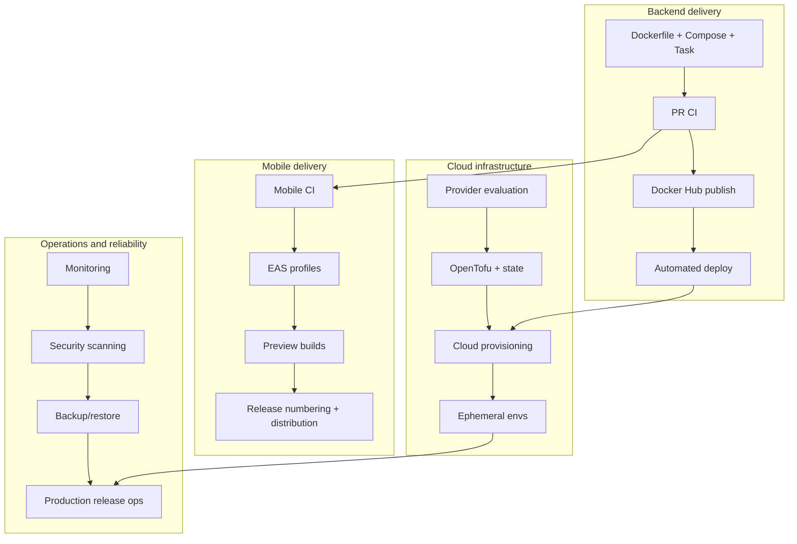

# CI/CD and Infrastructure Roadmap

**Status:** Proposed, dependency-aware roadmap. No calendar deadlines; complexity is relative (S / M / L / XL). This document is the single source of truth for phase sequencing and GitHub issue alignment.

## 1. Workstreams and dependencies

Four workstreams proceed in parallel where their dependencies allow.

**Minimum viable infrastructure milestone** (the smallest set that makes the product safe to collaborate on and deploy): Phases 1 and 2 (containerized backend + PR CI) plus the publishing slice of Phase 3. Everything else is additive.

## 2. Phase overview

| Phase | Objective | Complexity | Entry condition |
| --- | --- | --- | --- |
| 0 | Architecture and documentation foundation | S | This documentation set |
| 1 | Containerization and local infrastructure | M | None |
| 2 | Pull-request CI | M | Phase 1 |
| 3 | Artifact publishing and release metadata | M | Phase 2 |
| 4 | Self-hosted deployment infrastructure | L | Phase 3 + hardware decision |
| 5 | Expo EAS mobile delivery | M | Phase 2 (parallel with 3/4) |
| 6 | Cloud Infrastructure as Code | L | Provider decision |
| 7 | Ephemeral environments and cost automation | L | Phase 6 |
| 8 | Production release operations | L | Phases 3, 6; **not** 7 |
| 9 | Scale-driven infrastructure | XL | Operational evidence |

### Production readiness dependencies (correction K)

Production operations (Phase 8) require: a chosen hosting environment, reliable CI, approved release artifacts, secure deployment, an adequately operated database, backups and restore verification, monitoring, secret management, access controls, and rollback procedures.

Phase 8 does **not** require: automated PR preview environments, full ephemeral-environment lifecycle automation, Kubernetes, Ansible, or self-hosted image builds. Ephemeral-environment automation (Phase 7) is an optional capability that may run in parallel with, not before, production operations.

---

## 3. Phase details

### Phase 0 — Architecture and documentation foundation

- **Objective:** agree architecture, resolve audit inconsistencies, define versioning and conventions, map tickets.
- **Business value:** stable planning foundation for small, reviewable PRs.
- **Scope:** this documentation set; ADR 0002/0003; stale-document corrections.
- **Deliverables:** architecture, CI/CD, release, cloud, ephemeral, and roadmap docs; decision register.
- **Existing issues:** #29 (parent).
- **Dependencies:** none.
- **Acceptance criteria:** entry point discoverable; current vs proposed clearly separated; the corrections in the preceding audit are addressed.
- **Verification:** `git diff --check`; link review.
- **Security:** no secrets in docs.
- **Cost:** negligible.
- **Risks:** documentation drift if not maintained with implementation.
- **Exit criteria:** team reviews and accepts the direction.
- **Deferred:** all implementation.

### Phase 1 — Containerization and local infrastructure

- **Objective:** reproducible backend images and consistent developer commands.
- **Business value:** eliminates "works on my machine"; simplifies onboarding.
- **Scope:** multi-stage backend `Dockerfile` (`development`/`test`/`migrate`/`production`), `.dockerignore`, `compose.yaml` (`dev`/`test` profiles), `docker:*` Task tasks.
- **Deliverables:** buildable images; containerized testing; Compose lifecycle.
- **Existing issues:** #43, #3, #5 (refine), #4 (consolidate).
- **Dependencies:** none.
- **Acceptance criteria:** all targets build on a clean checkout; dev profile healthy; test profile runs green; existing host-native commands unchanged.
- **Verification:** local `docker build`/`docker compose` runs.
- **Security:** non-root production image; no baked secrets.
- **Cost:** negligible local.
- **Risks:** macOS host-network limitation for containerized DB tests (handled: host-native fallback).
- **Exit criteria:** contributors use the documented lifecycle.
- **Deferred:** publishing, CI, deployment.

### Phase 2 — Pull-request CI

- **Objective:** reliable validation on every PR to `develop`.
- **Business value:** fast, consistent feedback and a protected integration branch.
- **Scope:** `ci.yml` (four jobs), `setup-node-*` composite actions, PostgreSQL service, smoke test.
- **Deliverables:** green CI on the current codebase; clear contributor feedback.
- **Existing issues:** #30 (CI slice).
- **Dependencies:** Phase 1.
- **Acceptance criteria:** every PR runs all four checks; database safeguards preserved; failures actionable.
- **Verification:** representative PR run.
- **Security:** read-only token; no secrets; pinned actions; fork safety.
- **Cost:** free-tier runners.
- **Risks:** flaky integration tests (mitigate with readiness waits and `--runInBand`).
- **Exit criteria:** branch protection enables required checks.
- **Deferred:** CD, mobile binaries, publishing.

### Phase 3 — Artifact publishing and release metadata

- **Objective:** traceable deployable backend images.
- **Business value:** auditable commit-to-image chain.
- **Scope:** Docker Hub publish, OCI labels, build numbering, SemVer/release tooling, release manifest.
- **Deliverables:** `sha-*` + component release tags; digest deployment; provenance.
- **Existing issues:** #6 (registry exists), #30 (publish slice); new child tasks recommended.
- **Dependencies:** Phase 2.
- **Acceptance criteria:** merge publishes `sha-<sha>`; release publishes `backend/x.y.z`; labels populated.
- **Verification:** image inspect + provenance artifact.
- **Security:** Docker Hub token in environment secrets; digest-pinned deployment.
- **Cost:** registry storage; retention policy.
- **Risks:** mutable-tag misuse (mitigate with digest deploys).
- **Exit criteria:** a versioned, deployable image exists for the merged commit.
- **Deferred:** actual deployment.

### Phase 4 — Self-hosted deployment infrastructure

- **Objective:** automatic backend deployment to a development environment after successful merge.
- **Business value:** continuous delivery of the integration branch.
- **Scope:** self-hosted runner(s), `backend-deploy.yml`, migration step, health checks, rollback.
- **Deliverables:** secure local deploy runner; deployment records.
- **Existing issues:** #30 (CD slice).
- **Dependencies:** Phase 3; hardware/network decision.
- **Acceptance criteria:** validated merge deploys the exact digest; failed health checks roll back; ordering policy enforced.
- **Verification:** deploy + rollback drills.
- **Security:** build/deploy privilege separation; ephemeral deploy jobs; environments with reviewers.
- **Cost:** local hardware + network.
- **Risks:** credential exposure (mitigate via runner isolation).
- **Exit criteria:** development environment continuously deployed.
- **Deferred:** production, cloud IaC.

### Phase 5 — Expo EAS mobile delivery

- **Objective:** independent mobile build pipeline.
- **Business value:** reproducible native builds and internal distribution.
- **Scope:** `eas.json` profiles, `mobile-build.yml`, EAS remote build numbering, artifact tracking.
- **Deliverables:** development/preview/production builds; EAS build IDs recorded.
- **Existing issues:** none dedicated (new tasks recommended under #30).
- **Dependencies:** Phase 2 (parallel with Phases 3/4).
- **Acceptance criteria:** preview builds on relevant merges (Policy B default); manual production builds.
- **Verification:** successful EAS build + install.
- **Security:** EAS token in environment secrets; no secrets in `eas.json`.
- **Cost:** EAS quota; minimized by Policy B, dedupe, cancellation.
- **Risks:** quota exhaustion (mitigate with policy).
- **Exit criteria:** internal distribution works.
- **Deferred:** store submission automation.

### Phase 6 — Cloud Infrastructure as Code

- **Objective:** declarative, versioned cloud environments.
- **Business value:** reproducible, reviewable, destroyable infrastructure.
- **Scope:** provider selection, OpenTofu/Terraform, remote state, environment modules.
- **Deliverables:** `infrastructure/` tree; plan/apply workflows.
- **Existing issues:** #35 (refine to OpenTofu/Terraform + Ansible-if-VM).
- **Dependencies:** provider decision.
- **Acceptance criteria:** an environment can be planned, applied, and destroyed from version control; state is protected.
- **Verification:** plan review + controlled apply/destroy.
- **Security:** OIDC cloud credentials; protected, encrypted state.
- **Cost:** cloud resources only when provisioned.
- **Risks:** state mismanagement (mitigate with locking/versioning).
- **Exit criteria:** development environment is IaC-managed.
- **Deferred:** production, ephemeral automation.

### Phase 7 — Ephemeral environments and cost automation

- **Objective:** on-demand environments with TTL and safe teardown.
- **Business value:** QA/demo isolation without permanent cost.
- **Scope:** environment lifecycle, metadata, tagging, TTL, identity-scoped teardown, orphan detection.
- **Deliverables:** create/destroy automation; cost visibility.
- **Existing issues:** none dedicated (new tasks recommended under #29).
- **Dependencies:** Phase 6.
- **Acceptance criteria:** an ephemeral environment provisions, deploys, and destroys with no leftover resources; production is unreachable from generic destroy.
- **Verification:** teardown reconciliation.
- **Security:** production scope excluded; state-protected.
- **Cost:** reduced vs permanent environments; storage still billed.
- **Risks:** orphaned resources (mitigate with scheduled reconciliation).
- **Exit criteria:** TTL and teardown verified.
- **Deferred:** production lifecycle reuse.

### Phase 8 — Production release operations

- **Objective:** controlled production delivery.
- **Business value:** safe, recoverable releases of a financial product.
- **Scope:** production pipeline, approvals, backups/restore testing, monitoring, runbooks, rollback.
- **Deliverables:** production deploy workflow; backup/restore drill; runbooks.
- **Existing issues:** #34 (backups/DR), #32 (Sentry), #33 (prod DB).
- **Dependencies:** Phases 3 and 6; optional Phase 7.
- **Acceptance criteria:** releases require approval; backups tested; rollback practiced.
- **Verification:** restore and rollback drills.
- **Security:** production secrets isolated; least privilege; audit trails.
- **Cost:** production hosting + backups.
- **Risks:** data loss (mitigate with deletion protection and tested backups).
- **Exit criteria:** a production release is performed end to end.
- **Deferred:** horizontal scaling.

### Phase 9 — Scale-driven infrastructure

- **Objective:** scale only on operational evidence.
- **Business value:** avoid premature orchestration cost.
- **Scope:** evaluate Kubernetes, Redis/caching, background workers, GitOps, horizontal scaling.
- **Deliverables:** a documented, evidence-based decision and incremental rollout if adopted.
- **Existing issues:** #31, #36, #37, #38.
- **Dependencies:** demonstrated load/availability requirements.
- **Acceptance criteria:** scaling decision is evidence-based.
- **Verification:** load benchmarks and cost comparison.
- **Security:** no reduction in isolation or auditability.
- **Cost:** significant; justified by evidence.
- **Risks:** over-engineering (mitigate by deferring).
- **Exit criteria:** decision recorded (adopt or explicitly defer).
- **Deferred:** nothing further.

---

## 4. Decision register

### A. Agreed architectural requirements

- GitHub Actions `.github/actions/` + `.github/workflows/` convention.
- Docker Hub as the intended registry (subject to verification).
- Separate backend-deploy and EAS mobile workflows.
- `develop` as the integration branch.
- Ephemeral cloud environments as a long-term requirement.
- Backend and mobile independent versions.
- Deploy by immutable digest.

### B. Proposed technical defaults

- Node 24 LTS (Prisma-compatible `>=24.0`); `node:24-alpine`.
- OpenTofu for IaC.
- Managed container service + managed PostgreSQL for production.
- EAS change-aware preview builds (Policy B).
- Release Please for release automation.
- Initial runner topology Option A (local dev backend + isolated deploy runner).

### C. Decisions deferred to implementation gates

| Decision | Recommended default | Alternatives | Decision criteria | Latest phase | Consequence if unresolved |
| --- | --- | --- | --- | --- | --- |
| Docker Hub repo + permissions | Verify `edwardpeter547/expensetracker` | GHCR | Registry access confirmed | 3 | Publishing blocked |
| Cloud provider | Provider-agnostic modules until selected | — | Region, managed-PostgreSQL, OIDC, cost | 6 | IaC blocked |
| Local server hardware/OS | Linux VM/container host | — | Docker + runner requirements | 4 | Self-hosted deploy blocked |
| Production hosting region | Provider default | — | Data residency, latency | 6/8 | Production placement unknown |
| EAS credentials/profiles | Create `eas.json` at Phase 5 | — | Expo account access | 5 | Mobile builds blocked |
| Remote state backend | Provider object storage | Terraform Cloud/backend | Provider selection | 6 | IaC state unmanaged |
| Cloud cost budget | Provider budget alerts + quotas | — | Product funding | 7 | Ephemeral automation unbounded |
| Production approval policy | Required reviewer per environment | manual release | Compliance | 8 | Release controls undefined |

---

## 5. GitHub issue alignment (correction R)

| Issue | Current state (verified) | Phase | Action |
| --- | --- | --- | --- |
| #3 Dockerize Backend | OPEN | 1 | Refine: port 7001, no compile step, Prisma-generate stage, Compose profiles |
| #4 Development Dockerfiles | OPEN | 1 | Consolidate into #43/#3 (empty duplicate) |
| #5 Docker Compose | OPEN | 1 | Refine to Compose dev/test profiles + migration path |
| #6 Docker Hub Repository | CLOSED | 3 | Registry exists; verify name/access before publishing |
| #30 GitHub Actions CI/CD | OPEN | 2,3,4 | Split: CI (2), publish (3), deploy (4); defer mobile CD |
| #31 Kubernetes | OPEN | 9 | Defer |
| #32 Sentry | OPEN | 8 | Defer to production readiness |
| #33 Dockerize PostgreSQL | OPEN | 1,8 | Dev/test DB already exist; prod DB to Phase 8 |
| #34 PostgreSQL Setup | OPEN | 8 | Dev/migrations exist; backups/DR to Phase 8 |
| #35 Terraform & Ansible | OPEN | 6 | Refine to OpenTofu/Terraform; Ansible only if VM-based |
| #36 Redis | OPEN | 9 | Defer (no consumer) |
| #37 Celery | OPEN | 9 | Re-scope (Node queue, not Celery); defer |
| #38 Caching | OPEN | 9 | Defer (no measured bottleneck) |
| #43 Multi-Stage Dockerfile | OPEN | 1 | Implement directly (refine base/stages) |

### Missing tickets (proposed, report-only)

- Release engineering (component versioning, tags, manifests).
- Docker image publishing (under #30).
- Backend deployment automation (under #30).
- Self-hosted runner security (under #29/#30).
- Expo EAS builds (under #30).
- Cloud provider selection and IaC remote state (under #35).
- Ephemeral environments and safe teardown (under #29).
- Backup/restore, monitoring, and production release automation (under #33/#34/#32).

### Duplicate / mis-scoped

- #4 duplicates #43.
- #37 (Celery) is Python-specific for a Node backend.
- #35 bundles Terraform and Ansible though Ansible may be unnecessary.

### Implementation sequence

Phase 1 (#43, #3, #5) → Phase 2 (#30 CI) → Phase 3 (#30 publish + #6 verification) in parallel with Phase 5 (mobile) and Phase 4 (#30 deploy) → Phases 6–9 in order.
