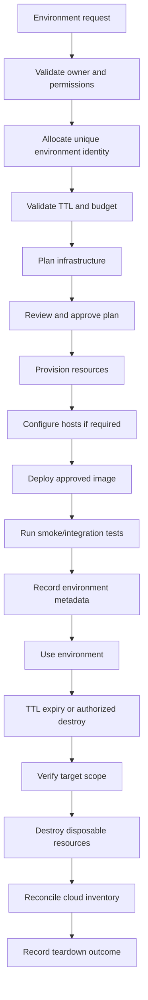

# Ephemeral Cloud Environments

**Status:** Proposed. No cloud environments exist today.

## 1. Objective

Provision short-lived cloud environments on demand and destroy them afterward to minimize cost, while guaranteeing that no teardown can destroy production financial data.

## 2. Lifecycle

## 3. Environment metadata

Every temporary environment records: unique environment ID, owner, purpose, creation timestamp, expiration timestamp, cloud account/project, IaC state identifier, Git commit, deployed image digest, resource tags, budget classification, and lifecycle status. Metadata lives in a registry (or the IaC state plus tags); it is the source of truth for teardown scoping.

## 4. Teardown authorization model

Destructive operations are **never** driven by tags alone. Tags support discovery and reconciliation, but destruction requires:

1. A verified environment identity.
2. The authorized, current IaC state for that identity.
3. The correct cloud account/project.
4. An approved resource set derived from that state.

The cleanup process must not delete pre-existing shared resources. A generic `infra-destroy.yml` is technically incapable of destroying production because it can only resolve non-production environment identities and states, and production uses a separate scope with its own credentials and deletion protection.

## 5. Failure handling

- **Partial provisioning:** the plan records created resources; a cleanup job destroys only resources the run created (verified from state), not pre-existing ones.
- **Failed deployment / smoke tests:** resources are retained briefly for diagnosis, then destroyed under TTL.
- **Interrupted workflow:** reconciliation flags the environment as indeterminate; a scheduled reconciler resolves it.
- **Expired environment:** TTL triggers the same identity-scoped teardown.
- **Failed teardown:** retried and flagged; not silently ignored.
- **Missing/corrupt state:** environment is quarantined; manual reconciliation required; never blanket-deleted.
- **Orphaned resources:** scheduled scans compare tagged inventory to active metadata and flag (not auto-delete) unmatched items.
- **Leaks:** public IPs, volumes, snapshots, DNS records, certificates, and service-account keys are enumerated in teardown and reconciled explicitly.

## 6. Production protection

- Separate production and non-production cloud scopes (accounts/projects or equivalent).
- Dedicated production state and distinct production credentials.
- Deletion protection on production databases, object storage, and state.
- Restricted destroy permissions; explicit, exceptional, human approval for production destruction.
- Backup retention and recovery procedures independent of compute.

Production financial data is never subject to generic ephemeral destruction.

## 7. Cost controls

- Resource TTLs and scheduled teardown.
- Budget alerts, quotas, and cost tagging (`environment`, `owner`, `project`).
- Idle detection and nightly shutdown.
- **Stop/start vs destroy/recreate:** stop/start is economical for stateful environments whose disks, snapshots, or attached managed databases must persist; destroy/recreate is cheaper for stateless environments because stopped compute still incurs disk, snapshot, managed-database, networking, and registry storage charges.
- Orphan detection and storage-retention policies.

## 8. Creation policy

Manual for QA/demo environments initially; automatic preview environments once the pattern is proven and only for trusted internal branches. Forked PRs are never provisioned.
